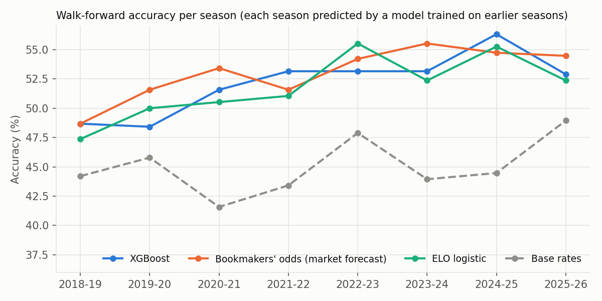
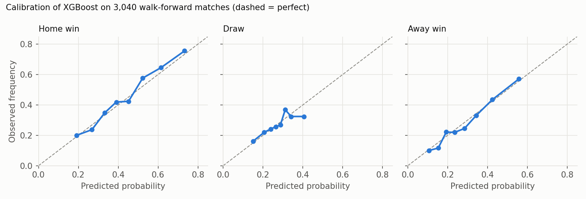
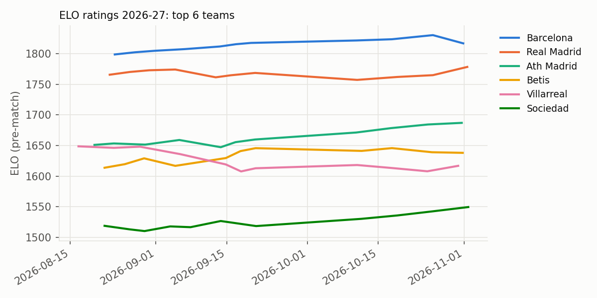

# La Liga Match Predictor

[](https://github.com/mmerino90/laliga_predictor/actions/workflows/tests.yml)
[](https://github.com/mmerino90/laliga_predictor/actions/workflows/predictions.yml)

**Live predictions → [mmerino90.github.io/laliga_predictor](https://mmerino90.github.io/laliga_predictor/)** (rebuilt automatically every day)

An XGBoost model that predicts La Liga results (home win / draw / away win) and scorelines from 11+ seasons of match data. It is benchmarked honestly against the betting market using walk-forward validation.

## Results

Every season from 2018-19 to 2025-26 is predicted by a model trained **only on earlier seasons**, using features computed **only from information available before kick-off**. That makes 3,040 out-of-sample matches.

> **What "Bookmakers" means here.** Betting odds are a forecast in disguise: odds of 2.00 mean the bookmaker thinks the outcome happens about 50% of the time. For each match I take the pre-match odds for home / draw / away from two sources, **Bet365** and the **market average across many bookmakers** published by football-data.co.uk, and turn them into probabilities (1 / odds). Those raw numbers add up to more than 100% because bookmakers build in a profit margin, so I scale them back to 100% and average the two sources.
> Example: odds of 2.00 / 3.40 / 3.80 → 50% / 29% / 26% (sum ≈ 106%) → **47% / 28% / 25%**.
> This "Bookmakers" row is not a model I trained. It is the betting market's own forecast, the hardest benchmark there is, because professional odds-setters and big bettors have every incentive to make it accurate.

| Model | Accuracy | Log-loss ↓ | RPS ↓ |
|---|---:|---:|---:|
| Base rates (always the historical H/D/A split) | 45.0% | 1.071 | 0.2247 |
| ELO only (logistic regression) | 51.8% | 0.997 | 0.1998 |
| Logistic regression, all features | 51.6% | 0.996 | 0.1976 |
| XGBoost without odds features | 50.8% | 1.005 | 0.2025 |
| **XGBoost (production model)** | **52.2%** | **0.990** | **0.1973** |
| XGBoost + isotonic calibration | 51.6% | 1.166 | 0.2013 |
| XGBoost, tuned + isotonic calibration | 51.5% | 1.167 | 0.2016 |
| *Bookmakers' odds (the betting market's forecast; benchmark, not my model)* | *53.0%* | *0.976* | *0.1939* |

*RPS (ranked probability score) is the standard metric for football forecasts. It rewards putting probability on outcomes close to what happened. Full numbers: [`results/metrics.json`](results/metrics.json).*



**What the numbers say**

- **The model is good, but the market is better.** XGBoost beats every simple baseline, but it trails the bookmakers by 0.9 accuracy points and 0.0033 RPS. The 95% bootstrap interval for that RPS gap is [0.0014, 0.0052], so the gap is small but real. Bookmakers already price in ELO, form, shots and more.
- **The engineered features carry real signal.** Without any odds input, XGBoost reaches 50.8%, against 45.0% for base rates. Adding the odds features gets it to 52.2%.
- **Calibration was already fine.** The raw XGBoost probabilities sit close to the diagonal (see the calibration plot below). Isotonic calibration fitted on one season *overfits* and hurts log-loss, so the production model is uncalibrated.
- **Draws are the hard part.** Draws are 27% of results but are rarely the most likely outcome. A draw-aware decision rule, tuned walk-forward, raises draw recall from 13% to 20% but lowers overall accuracy (52.2% → 51.9%), so it is not used.
- **Goals models beat the naive baseline.** Mean absolute error is 0.91 vs 1.00 for home goals and 0.79 vs 0.83 for away goals, compared with predicting the league average.

### A real forward test

On 2026-04-09 this repo committed predictions for the last 80 matches of 2025-26 ([`data/forward_test/`](data/forward_test/)), before any of them were played. Scored against what actually happened:

| | Accuracy | RPS ↓ |
|---|---:|---:|
| Committed predictions (old pipeline) | 50.0% | 0.221 |
| Bookmakers' odds, same 80 matches | 52.5% | 0.209 |

The old pipeline predicted a home win for **all 80** matches. Those fixtures had no odds, so the odds features were filled in with averages. The current pipeline reads upcoming odds from `fixtures.csv`, which fixes this.

### Lesson learned: a leakage bug

An earlier version of this project reported **58.1%** accuracy. That came from a bug: the "walk-forward" code re-indexed each test season from 0, so all seven test folds actually scored the same 114 matches from 2016, and those matches were also in the training data. Fixing the split dropped accuracy to the ~52% above. [`tests/test_pipeline.py`](tests/test_pipeline.py) now checks that every fold trains only on the past.

## How it works

```
football-data.co.uk CSVs ─► features.py ─► model.py ─► evaluate.py ─► results/ + site/data.json
  (results, shots, odds)     pre-match       XGBoost      walk-forward     plots, metrics, live site
```

**Features** (`laliga/features.py`). Matches are processed in kick-off order, and each row is recorded *before* its result updates the running state:

| Group | Details |
|---|---|
| ELO ratings | K=20, +60 home advantage, carried across seasons |
| Form | Points over the last 3 / 5 / 10 matches; goals for/against over the last 5 |
| Shots on target | Last 5 matches, for and against (less noisy than goals) |
| Venue form | The home team's last 5 home games, the away team's last 5 away games |
| Table | Points and goal difference per match; home/away points per match |
| Context | Head-to-head (last 5 meetings), rest days, matchday |
| Market | Bet365 + market-average odds, converted to probabilities with the margin removed |

**Models** (`laliga/model.py`)
- XGBoost multi-class classifier for H/D/A. Recent matches are weighted more (half-life of one season), and the number of trees is chosen by early stopping on the most recent 10% of the training data.
- Two XGBoost Poisson regressors give expected goals for each side. Treating them as independent Poisson variables gives a probability for every scoreline.





## Run it

```bash
git clone https://github.com/mmerino90/laliga_predictor.git
cd laliga_predictor
pip install -r requirements.txt
python run.py            # ~2-3 min: features, walk-forward evaluation, plots, predictions
python run.py --update   # download the latest results and fixtures first
pytest                   # leakage, feature and metric tests
```

To preview the site locally, run `python -m http.server --directory site` and open http://localhost:8000.

The walkthrough notebook [`laliga_predictor_walkthrough.ipynb`](laliga_predictor_walkthrough.ipynb) tours the data, features and results.

## Project structure

```
laliga/
  data.py        load the season CSVs and download updates
  features.py    pre-match feature engineering (ELO, form, shots, H2H, odds)
  model.py       XGBoost result/goals models, logistic + bookmaker baselines
  evaluate.py    walk-forward folds, metrics (accuracy, log-loss, RPS), bootstrap CIs, forward test
  plots.py       figures in results/
run.py           one-command pipeline
site/            static GitHub Pages site: index.html, generated data.json, and
                 predictions_log.json (every prediction published before kick-off, scored later)
results/         metrics.json, walk-forward predictions, plots
data/raw/        one CSV per season + upcoming fixtures (football-data.co.uk)
tests/           pytest suite
.github/workflows/
  tests.yml        run the tests on every push
  predictions.yml  daily: download, re-run, deploy the site (no commits)
```

## Limitations and next steps

- The model is frozen at the start of each test season. Retraining it during the season (e.g. monthly) would use more recent data.
- No team news: injuries, suspensions and rotation before European games are exactly where markets move and these features don't.
- Closing odds (available from 2019) would be a harder benchmark than the pre-match odds used here.

## Data

Match results, statistics and odds come from [football-data.co.uk](https://www.football-data.co.uk/spainm.php).
